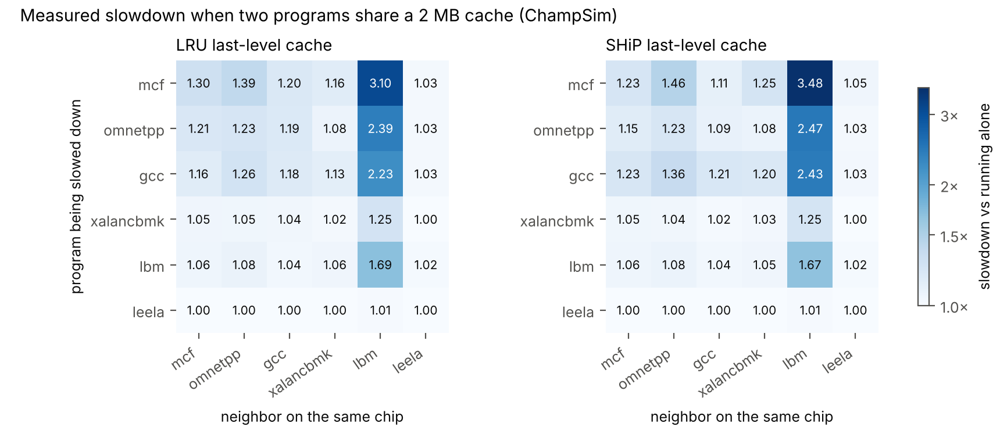
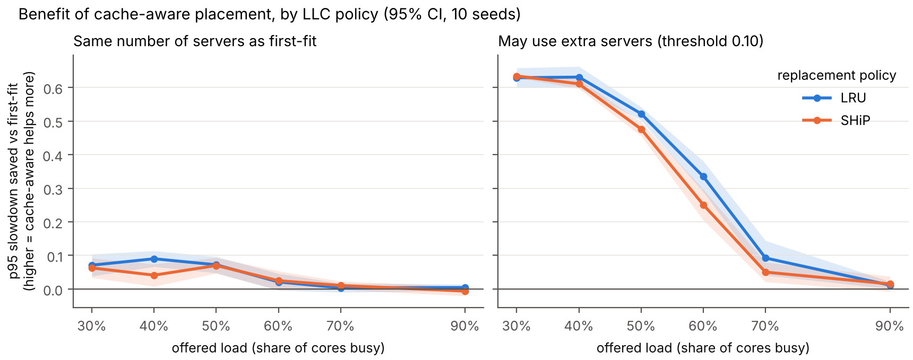
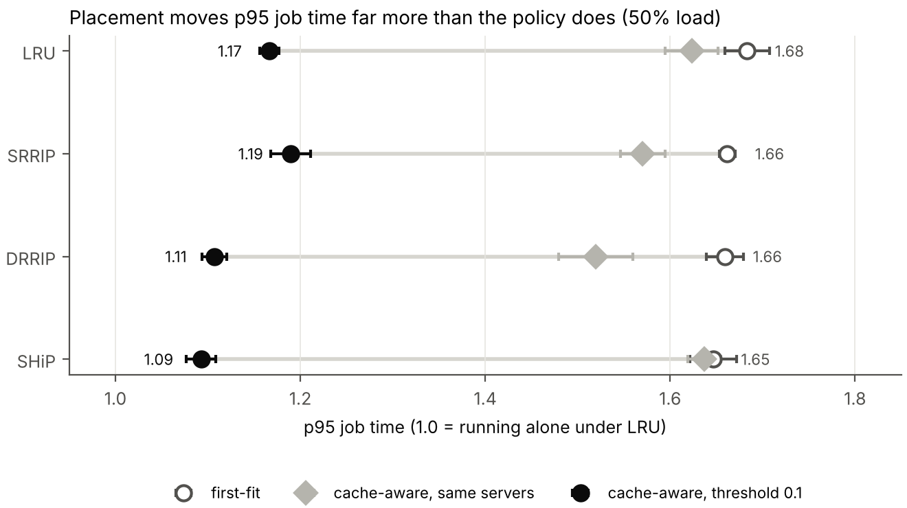
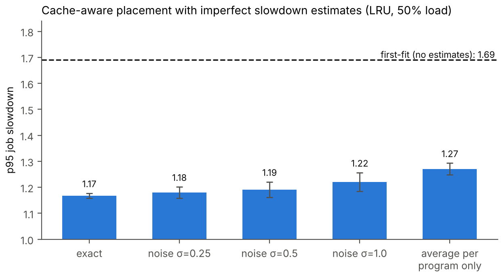
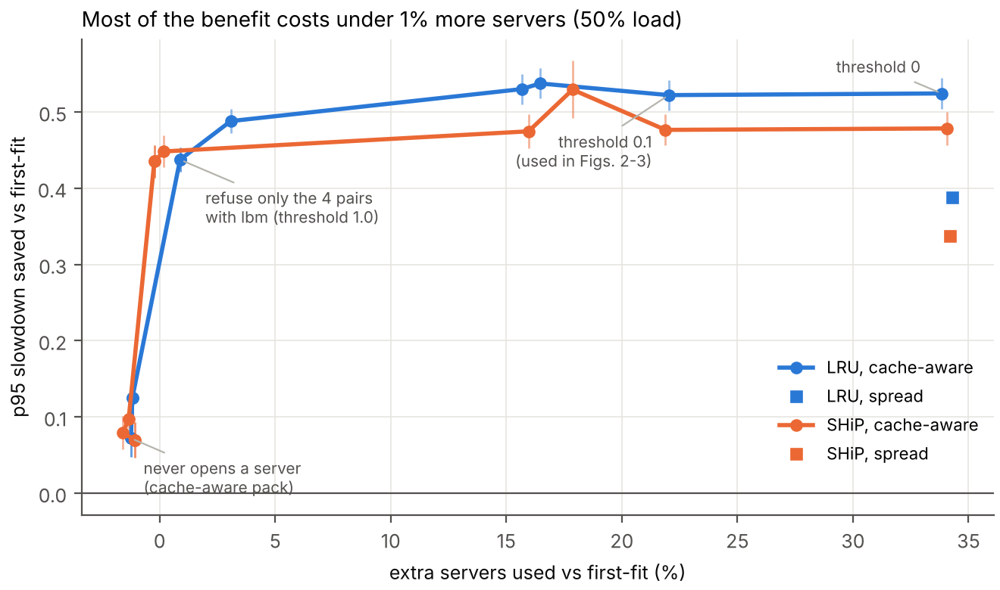

# Does smarter cache replacement change how clouds should place workloads?

Independent research project by Leslie Dotse (2026).

Cloud servers run several tenants on one processor, and those tenants share the
last-level cache (LLC). A cache-hungry neighbor slows everyone else down. Two
research communities attack this from different sides:

- **Cloud schedulers** place workloads so that bad neighbors don't share a server
  (e.g. Paragon, ASPLOS 2013; CacheVM, ICNP 2016).
- **Computer architects** design smarter LLC replacement policies so the
  hardware itself shares the cache better (e.g. SHiP, Hawkeye, Mockingjay).

CRUISE (ASPLOS 2012) showed that the two interact: smarter replacement eases the
scheduler's job, and the best co-schedule depends on the replacement policy. It
tested RRIP-era policies on a single chip. **This project revisits that question
with modern PC-based policies and evaluates it at cluster scale.**

## Research questions

1. Does a stronger replacement policy (SHiP / Mockingjay vs LRU) reduce the
   benefit of cache-aware workload placement in a cluster?
2. How fair are these policies when cloud-style workloads share an LLC?
3. How robust is cache-aware placement when its slowdown estimates are wrong?

## How it works

```
 ChampSim traces ──► solo + 2-core co-runs ──► slowdown table ──► cluster placement sim ──► results
 (architecture half: C++ simulator)            (one per policy)   (cloud half: Python)
```

1. **Measure.** For each replacement policy, run every workload alone and every
   pair of workloads together on a 2-core chip with a shared 2 MB LLC
   (ChampSim). Slowdown = solo IPC / co-run IPC.
2. **Place.** A discrete-event cluster simulator assigns arriving jobs to
   2-slot sockets using different schedulers. A job's speed while co-located
   comes from the measured slowdown table.
3. **Compare.** For each policy, how much does cache-aware placement improve
   job slowdown over cache-oblivious placement?

## Repository layout

| Path | What it is |
| --- | --- |
| `config/workloads.json` | The 6 workloads and their trace files |
| `scripts/setup_champsim.sh` | Clones and builds ChampSim, one binary per policy and core count |
| `scripts/download_traces.sh` | Downloads the SPEC CPU 2017 traces (DPC-3 set) |
| `scripts/make_configs.py` | Writes ChampSim JSON configs for each policy |
| `experiments/run_corun.py` | Runs all solo and pair simulations, builds slowdown tables |
| `src/placement/` | Cluster placement simulator and schedulers |
| `experiments/run_placement.py` | Runs the placement experiments (Q1, Q3) |
| `analysis/plots.py` | Makes the figures in `results/figures/` |
| `data/example_slowdown_PLACEHOLDER.csv` | **Made-up numbers** so the pipeline runs before real data exists. Never report results from it. |
| `tests/` | Sanity tests for the simulator |

## Quick start (macOS or Linux)

```bash
python3 -m venv .venv && source .venv/bin/activate
pip install -r requirements.txt
python -m pytest tests                     # simulator sanity checks
python experiments/run_placement.py --slowdown data/example_slowdown_PLACEHOLDER.csv --out results/demo
```

Real experiments, all in one command (needs about 5 GB of free disk and several hours of CPU):

```bash
bash scripts/run_all.sh        # build ChampSim, download traces, start all simulations in the background
tail -f results/run_all.log    # watch progress
```

Or step by step:

```bash
bash scripts/setup_champsim.sh            # builds ChampSim binaries into champsim/bin
bash scripts/download_traces.sh           # downloads the 6 traces (about 3.4 GB) into traces/
python experiments/run_corun.py --jobs 8  # solo + pair runs for every policy
python experiments/run_placement.py --slowdown results/slowdown_lru.csv results/slowdown_ship.csv --out results/q1
python analysis/plots.py results/q1
```

On an Apple Silicon Mac, ChampSim builds natively with Xcode command-line tools
(`xcode-select --install`) plus `brew install cmake pkg-config`. If the native
build fails, use the Docker route in `scripts/setup_champsim.sh --docker`.

## Schedulers compared

| Scheduler | Packs jobs? | Uses slowdown table? |
| --- | --- | --- |
| `first_fit` | yes | no |
| `random` | yes | no |
| `cache_aware_pack` | yes, exactly like first-fit | picks the least harmful neighbour |
| `cache_aware` | yes, unless every neighbour adds > 10% slowdown | yes, may open an extra socket |
| `spread` | no, uses an empty socket whenever one exists | no |

`cache_aware_pack` vs `first_fit` is the fair comparison: same number of busy
sockets, only the neighbour choice differs. `cache_aware` trades extra sockets
for speed, so always report `mean_busy_sockets` next to its slowdown.

## Results (first full run, October 2026)

108 ChampSim simulations: 6 SPEC CPU 2017 workloads, alone and in all 21 pairs,
under four LLC replacement policies (LRU, SRRIP, DRRIP, SHiP), with 20M warmup + 50M measured instructions per core on a
2-core chip with a shared 2 MB LLC. Placement experiments: 50 sockets, 3000
jobs per run, 10 seeds per setting, 95% confidence intervals. All numbers are
in `results/figures/key_numbers.csv`.

**1. Interference is dominated by one neighbor.** lbm (a streaming workload)
slows mcf down 3.10× under LRU, 3.18× under DRRIP and 3.48× under SHiP.
SRRIP, which inserts new lines with a low priority, protects best (2.51×).
leela is never slowed by more than 1.3%.



**2. Choosing a better neighbor alone helps little; refusing a few toxic pairings helps a lot.**
At 50% load, cache-aware packing (same number of servers as first-fit) cuts
p95 slowdown only from 1.69 to 1.62. Refusing just the 4 of 21 pairings that
include lbm cuts it to 1.25 with under 1% more servers. Refusing every pairing
that adds more than 0.10 slowdown reaches 1.17, but uses 22% more servers
(35.4 instead of 29.0). Above about 70% load the cluster is full and no
scheduler can help.

**3. The replacement policy barely changes the benefit of cache-aware placement.**
With extra servers allowed, the p95 reduction at 50% load is 0.52 (LRU), 0.50
(SRRIP), 0.48 (DRRIP) and 0.48 (SHiP). The smarter policies reduce the benefit
slightly (by 0.02-0.05 at 50% load, 0.08 for SHiP at 60%), which is the same
direction CRUISE (ASPLOS 2012) reported, but the effect is small next to the
benefit itself. With tight packing there is no reliable difference.



**4. In absolute job time, SHiP plus cache-aware placement is best.** p95 job
time at 50% load is 1.09× LRU's run-alone time with SHiP + cache-aware, vs
1.17× with LRU + cache-aware and 1.68× with LRU + first-fit.



**5. Estimates don't need to be precise.** With large random errors in the
slowdown estimates (σ = 1.0, log-normal), p95 slowdown rises only from 1.17 to
1.22 (first-fit: 1.69). Knowing only each program's average sensitivity gives
1.27.



Reproduce the analysis from the committed tables:

```bash
python experiments/run_placement.py --slowdown results/slowdown_lru.csv results/slowdown_srrip.csv results/slowdown_drrip.csv results/slowdown_ship.csv --loads 0.3 0.4 0.5 0.6 0.7 0.9 --out results/q1
python experiments/run_placement.py --absolute results/runs.csv --loads 0.3 0.4 0.5 0.6 0.7 0.9 --out results/q1_absolute
python experiments/run_placement.py --slowdown results/slowdown_lru.csv --loads 0.3 0.5 --noise 0 0.25 0.5 1.0 coarse --out results/q3
python analysis/figures.py
```

## Robustness checks

- **Threshold.** Sweeping cache_aware's threshold (`experiments/run_tradeoff.py`)
  shows that refusing only the 4 pairs that include lbm (threshold 1.0) keeps
  0.44 of the 0.52 p95 reduction at 50% load with under 1% extra servers
  (LRU; SHiP: 0.44 with no extra servers). Thresholds of 0.1-0.3 gain little
  more but use 16-22% more servers.



- **Job mix and cluster size.** `experiments/run_sensitivity.py` repeats the
  comparison with a cache-heavy mix, a streaming-heavy mix, and 20 or 200
  sockets. Cache-aware placement helps in every case; its benefit is smaller
  with fewer streaming jobs (0.23 at 50% load, cache-heavy) and larger with
  more (0.69, streaming-heavy). Results are in `results/sensitivity/summary.csv`.
- **Second trace window.** `bash scripts/run_window2.sh` reruns LRU and SHiP on
  a different region of each program (`config/workloads_window2.json`).

## Status

- [x] Repository, simulator and tests
- [x] ChampSim runs (solo + pairs) for LRU, SRRIP, DRRIP and SHiP
- [x] Placement experiments on the measured tables
- [ ] Absolute-time comparison (fig. 3) for SRRIP and DRRIP: needs the 4-policy `results/runs.csv`
- [x] Threshold, job-mix and cluster-size sensitivity
- [ ] Second trace window per benchmark (`scripts/run_window2.sh`)
- [ ] Port Mockingjay to current ChampSim (stretch goal)
- [ ] Technical report

## Limitations

Results come from simulation: a 2-core model with one shared LLC, one 50M
instruction window per benchmark, 6 workloads, and a simplified cluster model
where every job is one of those 6 programs, chosen uniformly. They show trends
under these assumptions, not production-cloud performance. The significance
tests above are not corrected for the 18 policy comparisons made, so treat single
borderline results with caution.

## License

MIT (this repository). ChampSim is distributed under its own license.
